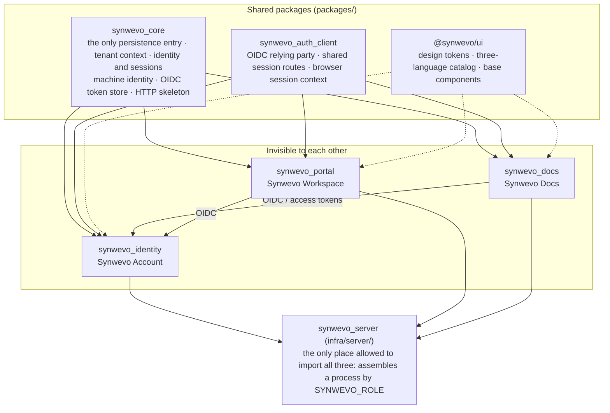

<div align="center">

<h1>
  <picture>
    <source media="(prefers-color-scheme: dark)" srcset="packages/ui/brand/derived/synwevo-logo-full-white.png">
    
  </picture>
</h1>

**Let workflows handle the repetitive work.**

A workflow automation platform: one unified account, one workspace portal, and the first business
application, **Synwevo Docs** (data mapping and batch document generation). Everything runs on your
own machine or server. No file ever leaves it.

[简体中文](README.md) · English

[](https://github.com/WeGreen-AI/Synwevo/actions/workflows/production.yml)


[Live](#live) · [Quick start](#quick-start) · [Architecture](#architecture) · [Machine API and automation](#machine-api-and-automation) · [Security model](#security-model) · [Documentation map](#documentation-map)

</div>

---

## What it is

Synwevo is three parts that are built, started and tested separately, sharing one account
authority and one design system:

| Part | Role | Directory |
|---|---|---|
| **Synwevo Workspace** | Public home page and the signed-in portal: which applications you have, workspace switching, account entry | `apps/portal/` |
| **Synwevo Account** | Unified account: password / passkey / TOTP / e-mail code / external identity provider sign-in, invitations and recovery, organization and workspace governance, platform administration, OIDC authorization server | `services/identity/` |
| **Synwevo Docs** | Document automation: pick data on the left, pick a template on the right, connect them, and batch-generate real DOCX / XLSX / PDF / PPTX / CSV / image files by sample rule | `apps/docs/` |

The platform's positioning is **workflow automation**. What it ships today is one complete document
automation flow: sources → template → mappings and sample rules → preflight → background job →
verifiable artifacts, exposed to machines through `/api/v1`, Python and Node SDKs, webhooks and n8n
workflows. A visual workflow builder **does not exist yet**; the flow illustration on the home page is
an illustration.

## Live

| Entry | URL |
|---|---|
| Platform home / workspace | <https://synwevo.wegreen.ltd> |
| Unified account (registration, sign-in, account and security) | <https://accounts.wegreen.ltd> |
| Synwevo Docs workbench | <https://docwave.wegreen.ltd> |

Registration is open with mailbox verification and grants no platform administration. The UI is
available in Simplified Chinese, Traditional Chinese and English. The deployment record and its
verification results are in [docs/quality/deployment.md](docs/quality/deployment.md).

## What Synwevo Docs does

**In one sentence:** take 1,000 customer rows from an Excel file, a Word contract template, and
produce 1,000 real contracts, each of which can be reopened and checked value by value.

* **Sources**: XLSX / XLSM / XLS / ODS / CSV / TSV, DOCX / DOC / ODT / RTF, PDF (text, AcroForm, scanned), PNG / JPEG / TIFF / BMP / WEBP / GIF, PPTX / PPT / ODP, TXT / Markdown / HTML. Formats are detected by content, not extension. Scans and images are OCRed locally with Tesseract, and low-confidence values must be confirmed by a person.
* **Templates**: upload DOCX / XLSX / PDF / PPTX / images and mark fill targets directly on the preview: text runs (across formatting), cells, ranges, repeating detail rows, paragraph blocks, headers and footers, PDF boxes (the original text is really removed), PDF form fields, image regions (pixels rebuilt from the surrounding background). Or build a template from scratch in the built-in document and spreadsheet editors. Versioned templates, undo / redo, a template library.
* **Sample rules**: one per row / per file / per group / per block. The number of outputs is decided by the rule alone, never inferred from the number of mappings, never a Cartesian product.
* **Mappings**: single value, fixed range, repeating detail; bound by column name so reordering columns is harmless; explicit multi-source composition; controlled transforms; numbered, colored, two-sided connectors.
* **Preview and generation**: real previews (same code path as generation), preflight with error policies, background jobs with real progress, cancel, retry failed items only, resume after a restart; single download, ZIP, a CSV manifest; file names composed from fields and safely de-duplicated.
* **Faithful output**: untouched OOXML parts are preserved byte for byte; XLSX formulas are computed by the built-in engine (97 common functions) and written as cached values, with unsupported functions handed to LibreOffice rather than guessed.

The full per-format capability matrix (verified, converted, not done and why) is in
[docs/FORMATS.md](docs/FORMATS.md); known limits are in [apps/docs/README.md](apps/docs/README.md#已知限制).
Product documentation is currently written in Chinese.

## Quick start

Python 3.12+ and Node 22 are required. Optional system tools: LibreOffice (legacy format conversion,
PDF export, fallback formula calculation) and Tesseract (OCR). When they are missing, the affected
capabilities show as "dependency missing" on the capabilities page instead of failing silently.

```bash
# optional dependencies on macOS
brew install --cask libreoffice && brew install tesseract
```

```bash
git clone git@github.com:WeGreen-AI/Synwevo.git synwevo && cd synwevo
python scripts/platform.py setup          # create .venv, install pinned deps, editable-install every module, build the three shells
python scripts/platform.py up --init      # first run: create an empty database; afterwards plain `up`
```

| Service | URL |
|---|---|
| Synwevo Workspace | <http://portal.localhost:8769> |
| Synwevo Account | <http://accounts.localhost:8770/login> |
| Synwevo Docs | <http://docweave.localhost:8765> |

There is no default administrator and no default password. Generate a one-time bootstrap token and
paste it on the sign-in page:

```bash
.venv/bin/python -m synwevo_identity.cli bootstrap token
```

Everyday commands:

```bash
python scripts/platform.py up accounts docs     # account service + Docs only (Docs keeps working with the portal down)
python scripts/platform.py status               # processes, ports, issuer
python scripts/platform.py logs docs -n 200     # accounts / portal / docs
python scripts/platform.py down
```

> **Why three hostnames instead of three ports?** Cookies are scoped by host and ignore the port,
> so a cookie set by `localhost:8770` is sent to `localhost:8765` too. `*.localhost` names all resolve
> to loopback (RFC 6761) with no hosts-file edit, yet they are three genuinely separate cookie jars.
> The `docweave.localhost` name stays as it is: it is a registered OIDC callback and passkey origin.

**Single-process form with Docker** (workbench and account pages on one origin; the image bundles
LibreOffice, Tesseract Chinese models and CJK fonts):

```bash
docker compose -f infra/docker-compose.yml up -d --build     # listens on 127.0.0.1:8765, data in ./data
```

Full guide (data location, mail modes, passkeys and certificates, troubleshooting):
[docs/development/local-platform.md](docs/development/local-platform.md).

## Architecture



```
repository root
├─ apps/
│   ├─ docs/          Synwevo Docs: engine (web-agnostic), business API, /api/v1, workbench UI, SDKs, tests, scripts
│   └─ portal/        Synwevo Workspace: public home, signed-in portal, application entry
├─ services/
│   └─ identity/      Synwevo Account: sign-in ceremonies, MFA, passkeys, invitations and recovery, organizations, platform admin, OIDC provider
├─ packages/
│   ├─ core/          shared: Store (the only migration runner), tenants, identity/sessions/passwords, machine identity, OIDC token store, HTTP skeleton
│   ├─ auth-client/   how an application joins the unified identity: OIDC relying party (python/), browser session context and platform navigation (web/)
│   └─ ui/            design tokens, theme, three-language catalog and base components shared by the three shells
├─ infra/             container build, single-process assembly (synwevo_server), production Compose and deployment receiver
├─ scripts/           root commands: setup, up, down, status, logs, test, backup, the three guard scripts
├─ tests/integration/ cross-module checks: unified sign-in chain, machine identity, cross-workspace isolation, role boundaries, shell ownership
├─ docs/              architecture, security contracts, integration, operations, quality records
└─ data/              runtime data (SQLite + content-addressed blobs), never committed
```

**The boundaries are why this repository exists; they are not a style preference.** The account
service must start with the document engine uninstalled, and Synwevo Docs must keep working with the
portal down. Those two sentences are either mechanically checkable facts or just sentences:

* No application imports another application's internals. No application imports the account service's implementation (the read-side it needs lives in `synwevo_core`).
* Shared packages never depend on applications, and only genuinely shared code goes into them.
* No `sys.path` rewriting, machine-specific absolute paths or symlinks to make an import work. Packages are installed.
* **One database, one migration runner.** There can be only one account authority: two databases are two answers to "is this person suspended".
* **One process, one role** (`accounts` / `portal` / `app` / `all`). Routes are mounted per role and a central gateway rejects per role.
* **Exactly one account and security UI** for the whole platform. On relying parties, `/login` and `/account` are server-side redirects, not local password forms.

```bash
python scripts/check_boundaries.py    # cross-module imports, sys.path rewriting, absolute paths, symlinks
```

Details and the reasoning behind each decision: [docs/architecture/monorepo.md](docs/architecture/monorepo.md),
[docs/architecture/platform.md](docs/architecture/platform.md).

## Machine API and automation

The UI and the API **share one engine, one service layer and one job system**: the same inputs,
template versions and rules produce the same business result either way.

| Path | Notes |
|---|---|
| `/api/v1` | projects, sources, templates and field definitions, rules and mappings, preflight, jobs, events, artifacts; idempotency keys, revision checks on concurrent writes, signed download links, optional RFC 9457 errors, `X-Request-ID` end to end |
| OpenAPI | [docs/integration/openapi.yaml](docs/integration/openapi.yaml) is exported from the real routes, and a test keeps it in sync with the code |
| Python SDK / CLI | [apps/docs/sdk/python](apps/docs/sdk/python/README.md): HTTPX is its only dependency; retries with backoff, resumable uploads, SHA-256-verified downloads, job waiting |
| Node client / CLI | [apps/docs/sdk/typescript](apps/docs/sdk/typescript/README.md): dependency-free ES module for Node 18+ |
| Webhooks | Standard Webhooks signatures (HMAC-SHA256, timestamp window, event-id de-duplication); receiver example in `apps/docs/examples/webhook_receiver.py` |
| n8n | [apps/docs/sdk/n8n](apps/docs/sdk/n8n/README.md): importable workflows using standard nodes only (generate + receive) |

Machine credentials are **service accounts** (OAuth 2.0 client credentials with audience and scope
narrowed to application / workspace / operation), issued by the account service and verified by Docs.
Legacy API keys remain supported. An ID token is never a general-purpose credential for the business API.

```python
from synwevo_docs_sdk import Client

with Client.from_env(timeout=30, max_retries=4) as client:
    project  = client.create_project("September contracts", idempotency_key="contracts-2026-09")
    source   = client.upload_source(project["id"], "customers.xlsx")
    template = client.upload_template("contract.docx")
    client.create_template_fields(template["id"], fields_definition)     # your own JSON definition
    client.set_project_template(project["id"], template["id"])
    client.put_definition(project["id"], project_definition)             # rule + mappings
    preflight = client.preflight(project["id"], formats=["docx"], simulate=1)
    job    = client.create_job(project["id"], formats=["docx"], idempotency_key="batch-2026-09")
    result = client.wait_for_job(job["id"], timeout=300)
    client.download_archive(job["id"], "results.zip")                     # every artifact checked against SHA-256
```

A complete headless flow from a clean environment, including a curl version:
[docs/integration/automation.md](docs/integration/automation.md). API semantics:
[docs/integration/api.md](docs/integration/api.md).

## Security model

**Signing in only proves who you are.** Every business request passes five layers, all enforced
server-side:

```
signed in ──► who this is (user_id, method and time of authentication)
               ├─ is the account active?
               ├─ is this user a member of this workspace, and in which role?
               ├─ does this workspace have this application enabled?
               ├─ is this user entitled to this application?
               └─ does this object really belong to this workspace? (authz.py, per object)
```

* **Platform administrators govern accounts and platform configuration and, by default, cannot read any business document.** The administrator API console requires `api_platform.manage`, but console rights never grant business content access. Service credentials are bounded by the intersection of a currently valid workspace approval, resource scope and token scope.
* **Authentication methods**: Argon2id passwords (parameters measured on the deployment host), passkeys / WebAuthn, TOTP with recovery codes, e-mail one-time codes, external OpenID providers (linked by `(provider, subject)`, never merged by e-mail alone).
* **Sessions**: three layers managed separately (central, per-application, tokens); cookies are host-only, `HttpOnly`, `SameSite=Lax`; idle and absolute clocks are enforced on read; sensitive operations require re-authentication; back-channel logout and revocation propagate.
* **Protocol**: Authlib implements OAuth 2.0 / OpenID Connect (authorization code + PKCE, refresh-token rotation with replay detection, revocation, introspection). No hand-rolled simplified protocol. Using a mature implementation is not the same as being OpenID certified.
* **Key material**: TOTP seeds sealed with AES-256-GCM; cookie values never stored (the sessions table is keyed by their SHA-256); API keys stored as hashes only.
* **Requests are not trusted**: the origin of e-mail links, the OIDC issuer and the listen address all come from configuration, never from the `Host` header; connections to the account service do not inherit `HTTP_PROXY`.
* **File handling**: LibreOffice runs with a private profile, a timeout and a CPU limit; macros, ActiveX, external links and PDF JavaScript are never executed; HTML is never rendered and never loads external resources.

Contracts and enforcement points: [docs/security/permissions.md](docs/security/permissions.md),
[docs/security/sessions.md](docs/security/sessions.md).

## Verification

```bash
.venv/bin/python -m pytest                     # three suites: apps/docs/tests, services/identity/tests, tests/integration
.venv/bin/python scripts/check_boundaries.py   # module dependency boundaries
.venv/bin/python scripts/check_brand.py        # legacy brand strings: each one is either removed or has a written reason to stay
.venv/bin/python scripts/check_design.py       # design system: literal colors only in the shared tokens
npm run typecheck && npm run build             # the three front-end shells
```

CI ([.github/workflows/production.yml](.github/workflows/production.yml)) runs the same checks on every
push and pull request and executes the full test suite against the production runtime in an isolated
container. Only `main` is deployed, after verification, through a restricted SSH command, followed by
`/readyz` checks on the three public origins. The latest deployment round (Python suite 1893 passed /
2 skipped, all front-end and guard checks passed) and the table-by-table, blob-by-blob data
preservation comparison are recorded in [docs/quality/deployment.md](docs/quality/deployment.md).

Additional verification scripts: `tests/integration/verify_sso.py` (measures cookie isolation across the
three origins with a real `http.cookiejar`), `tests/integration/automation_example.py` (token → job →
verified artifacts, no browser), `apps/docs/scripts/ui_e2e*.py` (Playwright drives a real Chrome through
the whole workbench). All tests use clearly marked synthetic data and never point at `data/`.

## Production deployment

`infra/production/` is what runs today: three roles plus an nginx gateway, one read-only-rootfs image
running as non-root with `cap_drop: ALL`, one shared data directory. A Cloudflare Tunnel provides public
HTTPS and no backend port is exposed. Data, keys and backups stay on the server, and SMTP credentials
reach the account container only.

```bash
python scripts/platform.py backup                      # consistent backup: SQLite backup API + blob manifest
python scripts/platform.py verify-restore <archive>    # really restore into an isolated copy, then compare item by item
python scripts/platform.py restore <archive> --into DIR  # restore and replay revocations recorded after the backup
```

Runbooks: [docs/operations.md](docs/operations.md), [infra/production/README.md](infra/production/README.md).
Every configuration key and limit: [.env.example](.env.example).

## Design system

The three shells have one visual source. White and light neutrals make the page; blue is reserved for
actions and emphasis. Colors, type scale, spacing, radii, shadows and motion are all tokens in
`packages/ui/src/styles.css`, with WCAG 2.2 AA contrast ratios written next to each token. Documents
people upload keep their own colors and layout. `scripts/check_design.py` makes sure no application
stylesheet grows its own palette. Contract: [docs/design.md](docs/design.md).

## Documentation map

Most documents are written in Chinese.

| You want to know | Read |
|---|---|
| Directories, module dependencies, data ownership, standalone boundaries | [docs/architecture/monorepo.md](docs/architecture/monorepo.md) |
| Why Authlib, why three hostnames, how the four ids differ | [docs/architecture/platform.md](docs/architecture/platform.md) |
| Starting from a clean machine, data location, mail modes, passkeys, FAQ | [docs/development/local-platform.md](docs/development/local-platform.md) |
| Synwevo Docs product notes, implemented flows, working assumptions, known limits | [apps/docs/README.md](apps/docs/README.md) |
| Per-format capability matrix | [docs/FORMATS.md](docs/FORMATS.md) |
| Workbench user guide | [docs/USER_GUIDE.md](docs/USER_GUIDE.md) |
| Machine API `/api/v1`: auth, routes, job semantics, idempotency, events and webhooks | [docs/integration/api.md](docs/integration/api.md) |
| Headless end-to-end flow with runnable scripts | [docs/integration/automation.md](docs/integration/automation.md) |
| Onboarding a new application to identity, portal and permissions | [docs/integration/app-onboarding.md](docs/integration/app-onboarding.md) |
| Ports, bind addresses, health checks | [docs/integration/ports.md](docs/integration/ports.md) |
| Permission layers and per-object authorization | [docs/security/permissions.md](docs/security/permissions.md) |
| Sessions, re-authentication, revocation, cross-application logout | [docs/security/sessions.md](docs/security/sessions.md) |
| Production start, backup and restore, migration and rollback | [docs/operations.md](docs/operations.md) |
| Current deployment and verification results | [docs/quality/deployment.md](docs/quality/deployment.md) |
| Current delivery round, evidence and open boundaries | [docs/quality/handoff.md](docs/quality/handoff.md) |
| Third-party components, versions and licenses | [docs/DEPENDENCIES.md](docs/DEPENDENCIES.md), [NOTICE](NOTICE) |
| Working rules (for people and AI agents alike) | [AGENTS.md](AGENTS.md) (root and per module) |

## Contributing

* Platform-level or cross-module changes start at the **repository root**; changes confined to Synwevo Docs start in `apps/docs/` and still follow the root `AGENTS.md`.
* A test that needs another module's routes to pass belongs in `tests/integration/`.
* No fake applications, empty services or placeholder dashboards. No mocks, fake sign-ins or fake data boards. Test fixtures are labelled as fixtures.
* Never claim "zero errors" without running the checks. Report passed / failed / skipped / not run separately.
* When you add an exception to `check_brand.py` or `check_design.py`, the written reason is the deliverable.

## License and data

* **Synwevo has not chosen a license yet.** Until a `LICENSE` file is added to the repository, no grant of rights should be assumed.
* PyMuPDF is AGPL-3.0 (or an Artifex commercial license). When it is enabled and the service is offered over a network, the corresponding-source obligation of AGPL-3.0 §13 applies; `/api/source-code` builds that archive from the **files actually running**. For an AGPL-free deployment, build from `apps/docs/requirements-pdfium.txt` and select the `pdfium` engine.
* All processing happens on your own machine or server; no file is sent to an external service and no paid component is required.
* User data, the database, key material and backups are never committed, never enter the image build context and are never written to logs.

---

<div align="center">
<sub>WeGreen-AI · <a href="https://github.com/WeGreen-AI/Synwevo">github.com/WeGreen-AI/Synwevo</a></sub>
</div>
