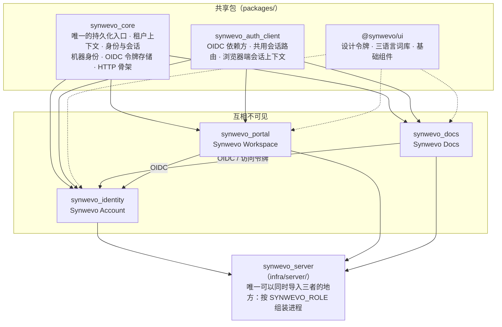

<div align="center">

<h1>
  <picture>
    <source media="(prefers-color-scheme: dark)" srcset="packages/ui/brand/derived/synwevo-logo-full-white.png">
    
  </picture>
</h1>

**把重复的工作，交给流程。**

工作流程自动化平台：一套统一账户、一个工作空间门户，以及第一个业务应用 **Synwevo Docs**
（数据映射与批量文档生成）。全部处理在本机或自有服务器完成，不向外部服务发送文件。

简体中文 · [English](README.en.md)

[](https://github.com/WeGreen-AI/Synwevo/actions/workflows/production.yml)


[在线体验](#在线体验) · [快速开始](#快速开始) · [架构](#架构) · [机器接口与自动化](#机器接口与自动化) · [安全模型](#安全模型) · [文档地图](#文档地图)

</div>

---

## 这是什么

Synwevo 由三个分开构建、分开启动、分开测试的部分组成，共用一个账户权威和一套设计规范：

| 部分 | 作用 | 目录 |
|---|---|---|
| **Synwevo Workspace** | 公开首页与登录后的工作空间门户：告诉你有哪些应用、切换工作空间、进入账户 | `apps/portal/` |
| **Synwevo Account** | 统一账户：口令 / Passkey / TOTP / 邮箱验证码 / 外部身份提供商登录，邀请与找回，组织与工作空间治理，平台管理后台，OIDC 授权服务器 | `services/identity/` |
| **Synwevo Docs** | 文档自动化应用：左侧选数据、右侧选模板、建立映射，按样本规则批量生成真实的 DOCX / XLSX / PDF / PPTX / CSV / 图片 | `apps/docs/` |

平台的定位是**工作流程自动化**。今天它交付的是一条完整的文档自动化流程：数据源 → 模板 → 映射与样本规则 →
预检 → 后台任务 → 可核对的产物，并把同一条流程通过 `/api/v1`、Python / Node SDK、Webhook 和 n8n 工作流开放给机器。
可视化流程编排器**尚未实现**，首页上的流程示意图只是示意。

## 在线体验

| 入口 | 地址 |
|---|---|
| 平台首页 / 工作空间 | <https://synwevo.wegreen.ltd> |
| 统一账户（注册、登录、账户与安全） | <https://accounts.wegreen.ltd> |
| Synwevo Docs 工作台 | <https://docwave.wegreen.ltd> |

线上开放邮箱验证注册；注册不授予任何平台管理权限。界面支持简体中文、繁體中文与 English。
部署记录与验证结果见 [docs/quality/deployment.md](docs/quality/deployment.md)。

## Synwevo Docs 能做什么

**一句话**：把一份 Excel 里的 1 000 行客户数据，按一份 Word 合同模板，生成 1 000 份真实的合同，每一份都能重新打开逐值核对。

* **来源**：XLSX / XLSM / XLS / ODS / CSV / TSV、DOCX / DOC / ODT / RTF、PDF（文本型、表单型、扫描型）、PNG / JPEG / TIFF / BMP / WEBP / GIF、PPTX / PPT / ODP、TXT / Markdown / HTML。按内容识别真实格式；扫描件与图片在本机用 Tesseract OCR，低置信度的值必须人工确认。
* **模板**：上传 DOCX / XLSX / PDF / PPTX / 图片后，直接在预览上选中内容「设为待填区域」：文字（可跨格式片段）、单元格、区域、重复明细行、段落块、页眉页脚、PDF 框选（真正删除原值）、PDF 表单字段、图片区域（按周围背景重建像素）。也可用内置的文档型与表格型编辑器从零创建。模板版本化、撤销 / 重做、模板库。
* **样本规则**：每行一份 / 每文件一份 / 每组一份 / 每块一份。输出数量只由样本规则决定，不根据映射数量推断，不做笛卡尔积。
* **映射**：单值、固定区域、重复明细；按列名绑定，列重排不受影响；多来源显式组合；受控转换；编号 + 颜色 + 连线双侧定位。
* **预览与生成**：真实预览（与生成同一路径）、生成前预检与错误策略、后台任务、真实进度、取消、仅失败项重试、服务重启后续跑；单个下载、ZIP、结果清单 CSV；文件命名可组合字段并安全去重。
* **忠实保留**：未修改的 OOXML 部件字节级保留；XLSX 公式由内置引擎（97 个常用函数）计算并写入结果，不支持的函数交给 LibreOffice，不猜测。

完整的逐格式能力矩阵（哪些已验证、哪些经转换、哪些不做及原因）在 [docs/FORMATS.md](docs/FORMATS.md)；
已知限制在 [apps/docs/README.md](apps/docs/README.md#已知限制)。

## 快速开始

需要 Python 3.12+ 与 Node 22。可选系统工具：LibreOffice（旧格式转换、PDF 导出、公式后备计算）与 Tesseract（OCR），
缺少时相关能力在「格式能力」页面标为「缺依赖」而不是静默失败。

```bash
# macOS 的可选依赖
brew install --cask libreoffice && brew install tesseract
```

```bash
git clone git@github.com:WeGreen-AI/Synwevo.git synwevo && cd synwevo
python scripts/platform.py setup          # 建 .venv、按锁定版本装依赖、可编辑安装各模块、构建三个前端
python scripts/platform.py up --init      # 首次：创建空数据库；之后只需 up
```

| 服务 | 地址 |
|---|---|
| Synwevo Workspace | <http://portal.localhost:8769> |
| Synwevo Account | <http://accounts.localhost:8770/login> |
| Synwevo Docs | <http://docweave.localhost:8765> |

没有默认管理员、没有默认口令。生成一次性引导令牌，在登录页粘贴：

```bash
.venv/bin/python -m synwevo_identity.cli bootstrap token
```

其它日常命令：

```bash
python scripts/platform.py up accounts docs     # 只起账户服务与 Docs（门户停掉，Docs 照常工作）
python scripts/platform.py status               # 进程、端口、发行者
python scripts/platform.py logs docs -n 200     # accounts / portal / docs
python scripts/platform.py down
```

> **为什么是三个主机名而不是三个端口？** Cookie 按主机划分作用域并忽略端口，`localhost:8770` 设的 Cookie 会照样发给
> `localhost:8765`。`*.localhost` 按 RFC 6761 全部解析到回环地址、不需要改 hosts 文件，却是三个互不相通的 Cookie 作用域。
> `docweave.localhost` 这个名字保持不变：它是注册过的 OIDC 回调与 Passkey 可信 origin。

**用 Docker 跑单进程形态**（工作台 + 账户页同一源站，镜像含 LibreOffice、Tesseract 中文模型与中文字体）：

```bash
docker compose -f infra/docker-compose.yml up -d --build     # 监听 127.0.0.1:8765，数据在 ./data
```

完整说明（数据位置、邮件模式、Passkey 与证书、常见问题）：[docs/development/local-platform.md](docs/development/local-platform.md)。

## 架构



```
仓库根目录
├─ apps/
│   ├─ docs/          Synwevo Docs：引擎（与 Web 无关）、业务接口、/api/v1、工作台前端、SDK、测试、脚本
│   └─ portal/        Synwevo Workspace：公开首页、登录后门户与应用入口
├─ services/
│   └─ identity/      Synwevo Account：登录仪式、MFA、Passkey、邀请与找回、组织治理、平台管理、OIDC 授权服务器
├─ packages/
│   ├─ core/          共享：Store（唯一的迁移执行者）、租户、身份/会话/口令、机器身份、OIDC 令牌存储、HTTP 骨架
│   ├─ auth-client/   应用接入统一身份：OIDC 依赖方（python/）、浏览器端会话上下文与平台导航（web/）
│   └─ ui/            三个外壳共用的设计令牌、主题、三语言词库、基础组件
├─ infra/             容器构建、单进程部署组装（synwevo_server）、生产 Compose 与部署接收器
├─ scripts/           根目录命令：安装、启动、停止、状态、日志、测试、备份、三个守卫脚本
├─ tests/integration/ 跨模块验证：统一登录链路、机器身份、跨工作空间隔离、角色边界、外壳归属
├─ docs/              架构、安全契约、接入、运维、质量记录
└─ data/              运行数据（SQLite + 内容寻址 blob）—— 不进 Git
```

**边界是这个仓库存在的理由，不是风格偏好。** 账户服务必须能在文档引擎缺席时启动，Synwevo Docs 必须能在门户停掉时继续工作。
这两句话要么是可机械检查的事实，要么只是一句话：

* 应用不得导入另一个应用的内部实现；应用不得导入账户服务的实现（它需要的读侧能力在 `synwevo_core`）。
* 共享包不反向依赖应用；只有真实共用的东西才进共享包。
* 不用 `sys.path` 改写、机器绝对路径或符号链接让 import 成立。包是装出来的。
* **一个数据库、一个迁移执行者。** 账户权威只能有一个：两个库就是"这个人是否已停用"的两个答案。
* **一个进程一个角色**（`accounts` / `portal` / `app` / `all`），路由按角色挂载，网关按角色集中拒绝。
* **账户与安全界面全平台只有一份**。依赖方上的 `/login`、`/account` 是服务端重定向，不是本地口令框。

```bash
python scripts/check_boundaries.py    # 跨模块导入、sys.path 改写、机器绝对路径、符号链接
```

细节与选型依据：[docs/architecture/monorepo.md](docs/architecture/monorepo.md)、[docs/architecture/platform.md](docs/architecture/platform.md)。

## 机器接口与自动化

界面与接口**共用同一套引擎、服务与任务系统**：同样的输入、模板版本和规则，得到同样的业务结果。

| 途径 | 说明 |
|---|---|
| `/api/v1` | 项目、来源、模板与字段定义、规则与映射、预检、任务、事件、产物；幂等键、并发修订校验、签名下载链接、RFC 9457 错误可选、`X-Request-ID` 全链路追踪 |
| OpenAPI | [docs/integration/openapi.yaml](docs/integration/openapi.yaml) 由实际路由导出，测试校验其与代码一致 |
| Python SDK / CLI | [apps/docs/sdk/python](apps/docs/sdk/python/README.md)：只依赖 HTTPX；重试与退避、续传上传、SHA-256 校验下载、任务等待 |
| Node 客户端 / CLI | [apps/docs/sdk/typescript](apps/docs/sdk/typescript/README.md)：零依赖 ES 模块，Node 18+ |
| Webhook | Standard Webhooks 签名（HMAC-SHA256、时间戳窗口、事件 id 去重）；接收器示例 `apps/docs/examples/webhook_receiver.py` |
| n8n | [apps/docs/sdk/n8n](apps/docs/sdk/n8n/README.md)：只用标准节点的可导入工作流（生成 + 接收） |

机器凭据是**服务账户**（OAuth 2.0 客户端凭证，令牌受众与 scope 精确到应用 / 工作空间 / 操作），由账户服务签发、由 Docs 校验；
旧式 API 密钥仍受支持。ID Token 不能当作业务 API 的通用凭证。

```python
from synwevo_docs_sdk import Client

with Client.from_env(timeout=30, max_retries=4) as client:
    project  = client.create_project("九月合同", idempotency_key="contracts-2026-09")
    source   = client.upload_source(project["id"], "customers.xlsx")
    template = client.upload_template("contract.docx")
    client.create_template_fields(template["id"], fields_definition)     # 你自己的 JSON 定义
    client.set_project_template(project["id"], template["id"])
    client.put_definition(project["id"], project_definition)             # 规则 + 映射
    preflight = client.preflight(project["id"], formats=["docx"], simulate=1)
    job    = client.create_job(project["id"], formats=["docx"], idempotency_key="batch-2026-09")
    result = client.wait_for_job(job["id"], timeout=300)
    client.download_archive(job["id"], "results.zip")                     # 逐产物核对 SHA-256
```

从零开始的完整无界面流程（含 curl 版）：[docs/integration/automation.md](docs/integration/automation.md)；
接口语义：[docs/integration/api.md](docs/integration/api.md)。

## 安全模型

**登录只证明身份。** 每一次业务请求都要过五层，且都在服务端强制：

```
登录成功 ──► 这是谁（user_id，认证方式与时间）
              ├─ 账户状态是否 active？
              ├─ 是不是这个 workspace 的成员？角色是什么？
              ├─ 这个 workspace 启用了这个应用吗？
              ├─ 这个用户对这个应用有资格吗？
              └─ 这个对象真的属于这个 workspace 吗？（authz.py，逐对象）
```

* **平台管理员治理账户与平台配置，默认读不到任何业务文档。** 管理员 API 台需要 `api_platform.manage`，但控制台权限不授予业务内容访问；服务凭据必须受当前有效的工作空间批准、资源范围与 scope 交集限制。
* **认证方式**：Argon2id 口令（参数在部署机实测）、Passkey / WebAuthn、TOTP 与恢复码、邮箱验证码、外部 OpenID 提供商（按 `(provider, subject)` 关联，不凭邮箱合并账户）。
* **会话**：三层会话分开管理（中央、应用、令牌）；Cookie host-only、`HttpOnly`、`SameSite=Lax`；空闲与绝对两个时钟在读取时强制；敏感操作要求重认证；后通道登出与撤权传播。
* **协议**：Authlib 实现 OAuth 2.0 / OpenID Connect（授权码 + PKCE、刷新令牌轮换与重放检测、撤销、内省），不手写简化协议。使用成熟实现不等于通过了 OpenID 认证。
* **密钥材料**：TOTP 种子 AES-256-GCM 封存；Cookie 原文从不落地（会话表主键是其 SHA-256）；API 密钥只保存哈希。
* **不信任请求**：邮件链接的来源、OIDC 发行者、监听地址都来自配置而不是 `Host` 头；到账户服务的连接不继承 `HTTP_PROXY`。
* **文件处理**：LibreOffice 在私有配置目录、超时与 CPU 限制下运行；宏、ActiveX、外部链接、PDF JavaScript 不执行；HTML 不渲染、不加载外部资源。

契约与强制点：[docs/security/permissions.md](docs/security/permissions.md)、[docs/security/sessions.md](docs/security/sessions.md)。

## 验证

```bash
.venv/bin/python -m pytest                     # 三个套件：apps/docs/tests、services/identity/tests、tests/integration
.venv/bin/python scripts/check_boundaries.py   # 模块依赖边界
.venv/bin/python scripts/check_brand.py        # 旧品牌残留：每一处要么改掉，要么写清为什么保留
.venv/bin/python scripts/check_design.py       # 设计系统：字面颜色只允许出现在共享令牌里
npm run typecheck && npm run build             # 三个前端外壳
```

CI（[.github/workflows/production.yml](.github/workflows/production.yml)）在每次 push 与 PR 上跑同一组检查，并在隔离容器里以生产运行时执行完整测试套件；
只有 `main` 通过验证后才经受限 SSH 命令部署，随后核对三个公开域名的 `/readyz`。
最近一次部署轮的结果（Python 套件 1893 通过 / 2 跳过、前端与守卫全部通过）与逐表逐 blob 的数据保全比对记录在
[docs/quality/deployment.md](docs/quality/deployment.md)。

补充的验证脚本：`tests/integration/verify_sso.py`（用真实 `http.cookiejar` 量三个来源的 Cookie 隔离）、
`tests/integration/automation_example.py`（无浏览器取令牌 → 提交任务 → 取回并校验产物）、
`apps/docs/scripts/ui_e2e*.py`（Playwright 驱动真实 Chrome 走完整工作台流程）。
测试全部使用明确标记的合成数据，从不指向 `data/`。

## 生产部署

`infra/production/` 是当前线上的形态：三个角色 + nginx 网关，同一个只读根文件系统镜像、非 root、`cap_drop: ALL`，共用一个数据目录；
Cloudflare Tunnel 提供公网 HTTPS，后端端口不暴露。数据、密钥与备份留在服务器，SMTP 凭据只进账户容器。

```bash
python scripts/platform.py backup                     # 一致性备份：SQLite 备份 API + blob 清单
python scripts/platform.py verify-restore <归档>      # 在隔离副本上真的恢复出来再逐项比对
python scripts/platform.py restore <归档> --into DIR  # 恢复并重放备份之后的撤销记录
```

运维手册：[docs/operations.md](docs/operations.md)、[infra/production/README.md](infra/production/README.md)；
全部配置项与上限：[.env.example](.env.example)。

## 设计系统

三个外壳只有一套视觉来源：白色与浅中性色构成页面，蓝色只用于操作与强调；颜色、字号、间距、圆角、阴影、动效全部是
`packages/ui/src/styles.css` 里的令牌，对比度按 WCAG 2.2 AA 写在令牌旁；用户上传的文档保留自身颜色与排版。
`scripts/check_design.py` 保证应用样式表不再各写一套色板。契约见 [docs/design.md](docs/design.md)。

## 文档地图

| 想知道 | 看这里 |
|---|---|
| 目录、模块依赖、数据所有权、独立运行边界 | [docs/architecture/monorepo.md](docs/architecture/monorepo.md) |
| 为什么选 Authlib、为什么三个主机名、四个 id 的区别 | [docs/architecture/platform.md](docs/architecture/platform.md) |
| 从干净环境启动、数据位置、邮件模式、Passkey、常见问题 | [docs/development/local-platform.md](docs/development/local-platform.md) |
| Synwevo Docs 产品说明、已实现流程、工作假设、已知限制 | [apps/docs/README.md](apps/docs/README.md) |
| 逐格式能力矩阵 | [docs/FORMATS.md](docs/FORMATS.md) |
| 工作台操作说明 | [docs/USER_GUIDE.md](docs/USER_GUIDE.md) |
| 机器接口 `/api/v1`：鉴权、路由、任务语义、幂等、事件与 Webhook | [docs/integration/api.md](docs/integration/api.md) |
| 无界面完整流程与可运行脚本 | [docs/integration/automation.md](docs/integration/automation.md) |
| 新应用如何接入统一身份、门户与权限 | [docs/integration/app-onboarding.md](docs/integration/app-onboarding.md) |
| 端口、绑定地址、健康检查 | [docs/integration/ports.md](docs/integration/ports.md) |
| 权限分层与逐对象授权 | [docs/security/permissions.md](docs/security/permissions.md) |
| 会话、重认证、撤销与跨应用登出 | [docs/security/sessions.md](docs/security/sessions.md) |
| 生产启动、备份恢复、迁移与回滚 | [docs/operations.md](docs/operations.md) |
| 当前部署与验证结果 | [docs/quality/deployment.md](docs/quality/deployment.md) |
| 本轮交付、证据与未完成边界 | [docs/quality/handoff.md](docs/quality/handoff.md) |
| 第三方组件、版本与许可 | [docs/DEPENDENCIES.md](docs/DEPENDENCIES.md)、[NOTICE](NOTICE) |
| 工作规则（人和 AI 代理都遵守） | [AGENTS.md](AGENTS.md)（根目录与各模块） |

## 参与开发

* 平台级或跨模块的改动从**仓库根目录**开始；只改 Synwevo Docs 从 `apps/docs/` 开始，仍遵守根目录 `AGENTS.md`。
* 一个测试如果需要另一个模块的路由才能通过，它属于 `tests/integration/`。
* 不建假应用、空服务、占位仪表盘；不 Mock、不假登录、不假数据看板；测试夹具要标明是夹具。
* 不在没有实测的情况下宣称"零错误"：报告 passed / failed / skipped / not run 要分开。
* 改 `check_brand.py` 或 `check_design.py` 的例外表时，理由本身就是产出。

## 许可与数据

* **Synwevo 尚未选定许可证。** 在仓库加入 `LICENSE` 文件之前，不应假定任何授权条款。
* PyMuPDF 为 AGPL-3.0（或 Artifex 商业许可）。启用它并对外提供服务时，AGPL-3.0 §13 的对应源代码提供义务适用；
  `/api/source-code` 由**正在运行的文件**生成该压缩包。需要无 AGPL 依赖的部署，按 `apps/docs/requirements-pdfium.txt` 构建并选择 `pdfium` 引擎。
* 所有处理在本机或自有服务器完成，不向外部服务发送文件；无需任何付费组件。
* 用户数据、数据库、密钥与备份不进 Git、不进镜像上下文、不写入日志。

---

<div align="center">
<sub>WeGreen-AI · <a href="https://github.com/WeGreen-AI/Synwevo">github.com/WeGreen-AI/Synwevo</a></sub>
</div>
